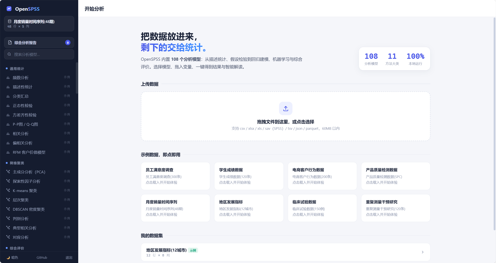

# OpenSPSS — 开源统计分析平台

> 参考 [SPSSPRO](https://www.spsspro.com/) 复现的开源自用数据分析工具:**100 个分析模型**,覆盖描述统计、假设检验、回归建模、降维聚类、机器学习、综合评价、时间序列预测、医学统计、质量管理、问卷研究与统计绘图。纯 Python 本地运行,现代 Web 界面,一键打包分发。



## 功能特性

- **100 个分析模型 / 11 大类** —— 与主流在线统计平台的方法体系对齐(见下方完整清单)
- **智能解读** —— 每个模型自动生成结论文本:统计量、p 值、显著性判断、效应量一目了然
- **可视化图表** —— 内置 ECharts:热力图、箱线图、散点图、岭迹图、ROC 曲线、控制图、树状图等,支持导出 PNG
- **数据管理** —— 上传 csv / xlsx / xls / sav(SPSS) / tsv / json / parquet;内置 7 套示例数据即点即用
- **变量类型系统** —— 定量 / 定类 / 定级三级类型,分析时自动校验,定类变量自动哑变量化
- **数据处理工作台** —— 缺失值填充、异常值缩尾、标准化、哑变量、分箱重编码、计算变量、筛选排序
- **结果导出** —— 一键导出 Excel(全部表格),单表/单图亦可导出
- **综合分析报告** —— 会话内每次分析自动汇总成报告页,一键导出独立 HTML 报告(可打印为 PDF)
- **纯本地运行** —— 无需注册、无网络依赖(ECharts 已本地化),数据不出本机
- **数据落盘** —— 上传/示例的数据集自动保存到本地数据目录(exe:%APPDATA%\OpenSPSS\datasets;源码运行:data/datasets,可用 OPENSPSS_DATA_DIR 覆盖),重启自动恢复;删除数据集同步删文件

## 快速开始

### 方式一:从源码运行(Python ≥ 3.10)

```bash
# 1. 创建虚拟环境
python -m venv .venv

# 2. 激活虚拟环境
# Windows:
.venv\Scripts\activate
# macOS / Linux:
source .venv/bin/activate

# 3. 安装
pip install -e .

# 4. 启动(自动打开浏览器)
open-spss
# 或:python -m open_spss
# 自定义端口:open-spss --port 9000 --host 127.0.0.1 --no-browser
```

访问 http://127.0.0.1:8420 ,点击任意示例数据即可开始分析。

### 方式二:安装分发包(wheel)

```bash
pip install dist/open_spss-1.0.0-py3-none-any.whl
open-spss
```

### 方式三:打包为独立可执行文件(免 Python 环境)

```bash
pip install -e ".[exe]"
pyinstaller openspss.spec
# 产物为 dist/OpenSPSS.exe,双击即用
```

- **双击启动**:约 1 秒内显示品牌过渡图(覆盖解压等待期),服务就绪后自动打开浏览器;
- **端口说明**:默认使用 8420;若端口被其他程序占用会自动向后换空闲端口,若已有 OpenSPSS 在运行则直接打开其页面(可多开不冲突);
- **无命令行窗口**:后台静默运行;异常信息写入 `%TEMP%/OpenSPSS.log`;
- **退出方式**:应用左下角「退出」按钮(停止本地服务),或任务管理器结束 OpenSPSS.exe 进程。

Linux/macOS 用户可用附带的一体化启动脚本:

```bash
bash scripts/start.sh     # 自动创建 venv、安装依赖并启动
```

## 模型清单(100 个)

| 大类 | 模型 |
|---|---|
| **通用统计** | 频数分析、描述性统计、分类汇总、正态性检验(S-W / K-S / JB)、方差齐性检验(Levene / Bartlett)、P-P 图 / Q-Q 图、相关分析(Pearson / Spearman / Kendall)、RFM 客户价值模型(8 层分层) |
| **差异检验** | 单样本 T 检验、独立样本 T 检验(自动 Welch)、配对样本 T 检验、单因素方差分析(LSD / Tukey / Scheffe 事后检验)、多因素方差分析(交互效应)、协方差分析(调整均值)、卡方检验(交叉分析 + Fisher)、卡方拟合优度检验、配对卡方 McNemar、单样本 Wilcoxon、Mann-Whitney U、Kruskal-Wallis(Bonferroni 两两比较)、Friedman、符号检验、事后多重比较(LSD / Bonferroni / Holm / Tukey / Scheffe) |
| **回归建模** | 多元线性回归(VIF / DW / 逐步法)、分层回归(ΔR² 检验)、二元 / 多分类 / 有序 Logistic 回归(OR 值)、Probit 回归(边际效应)、泊松 / 负二项回归(IRR,自动检验过离散)、分位数回归、稳健回归 RLM(与 OLS 对比)、曲面响应回归 RSM(驻点 / 等高线)、岭回归(岭迹图)、Lasso 回归(路径图)、曲线估计(7 种曲线) |
| **降维聚类** | 主成分分析(碎石图 / 载荷 / 得分 / 权重)、探索性因子分析(varimax 旋转)、K-means(肘部图 / 轮廓系数)、层次聚类(树状图)、DBSCAN、判别分析(LDA)、典型相关分析、对应分析(双标图) |
| **综合评价** | 层次分析法 AHP(一致性检验)、熵值法、TOPSIS(熵权 / AHP 权重)、灰色关联分析、模糊综合评价、秩和比 RSR、耦合协调度、CRITIC 权重、DEA-CCR 数据包络、组合权重(AHP+熵权)、变异系数权重、主成分权重、因子分析权重、DEMATEL 因果分析、ISM 解释结构模型、德尔菲法(Kendall W 协调系数) |
| **机器学习** | 决策树、随机森林、SVM、KNN、朴素贝叶斯、神经网络 MLP、梯度提升树 GBDT、异常检测·孤立森林(自动标记回写)——均自动识别分类 / 回归,含混淆矩阵、特征重要性、预测回写 |
| **时间预测** | ARIMA(AIC 自动定阶 + 置信带)、灰色预测 GM(1,1)(后验差检验)、灰色 Verhulst(S 型饱和增长)、指数平滑(Holt / Holt-Winters)、移动平均、马尔科夫预测(状态转移矩阵) |
| **医学统计** | ROC 曲线(AUC + 约登截断)、Kappa 一致性(加权)、Cox 比例风险回归(HR + C-index)、Kaplan-Meier 生存曲线、Log-rank 生存曲线比较、诊断试验评价(灵敏度 / 特异度 / 约登 / PPV / NPV / 似然比) |
| **质量管理** | X̄-R 控制图、X-MR 单值-移动极差控制图、p 控制图、过程能力分析(Cp / Cpk / PPM)、验收抽样(OC 曲线,α/β 风险核查) |
| **问卷研究** | 信度分析(Cronbach α / CITC / 折半)、效度分析(KMO + Bartlett)、项目分析(临界比值法)、多选题分析(响应率 / 普及率)、IPA 重要性-满意度四象限分析 |
| **统计绘图** | 直方图、箱线图、散点图、折线图、条形图、饼图 / 环形图、雷达图(自动归一化)、帕累托图(累计占比)、漏斗图 |

## 使用指南

1. **载入数据** —— 首页拖入文件,或点击示例数据卡片;
2. **检查变量类型** —— 数据页点击列头/变量芯片可切换定量 / 定类 / 定级;
3. **选择模型** —— 左侧模型树(支持搜索),按提示把变量加入槽位、调整选项;
4. **运行分析** —— 得到智能解读、结果表格与图表,可切换标签页查看;
5. **导出结果** —— 「导出 Excel」保存全部表格,图表支持 PNG 下载;
6. **综合分析报告** —— 本次会话的每次分析自动汇总到「综合分析报告」页(侧边栏),带目录与图表,一键导出为**独立 HTML 报告**(内嵌图表 PNG,浏览器打印即可转 PDF)。

分析中产生的派生数据(主成分得分、聚类类别、预测值等)会自动写回数据集,可继续用于后续分析。

## 项目结构

```
open-spss/
├── open_spss/
│   ├── core/            # 注册表、数据集管理、结果结构、ECharts 构建器
│   ├── models/          # 12 个模块文件,100 个模型实现
│   ├── web/             # 前端 SPA(原生 JS + ECharts,无构建步骤)
│   ├── app.py           # FastAPI 服务
│   ├── processing.py    # 数据处理操作
│   ├── samples.py       # 内置示例数据集
│   └── cli.py           # 命令行入口
├── tests/               # 全模型冒烟测试(100/100 通过)
├── scripts/             # 一体化启动 / 构建脚本
└── openspss.spec        # PyInstaller 打包配置
```

## 添加新模型

只需三步:在 `open_spss/models/` 写一个 runner 函数 → 用 `ModelSpec` 声明槽位与选项 → `register_model` 注册。前端表单、变量类型校验、结果渲染、Excel 导出全部自动生效:

```python
@register_model  # 或 register_model(ModelSpec(...))
def _run_my_model(ds, sl, op) -> Result: ...

register_model(ModelSpec(
    id="my_model", name="我的模型", category="通用统计",
    desc="一句话说明",
    slots=[Slot("y", "因变量(定量)", types=(QUANT,))],
    options=[Option("method", "方法", "select", default="a",
                    choices=[{"value": "a", "label": "方法A"}])],
    runner=_run_my_model,
))
```

## 测试

```bash
pytest tests/ -q      # 全模型冒烟测试
```

## 技术栈

FastAPI · Uvicorn · pandas · NumPy · SciPy · statsmodels · scikit-learn · openpyxl · pyreadstat · Apache ECharts(本地化)· 原生 JavaScript

## License

MIT — 见 [LICENSE](LICENSE)。

> 本项目为学习研究性质的开源复现,与 SPSSPRO 官方无关;方法实现以 scipy / statsmodels / scikit-learn 等开源库为准,结果解读仅供科研参考。
